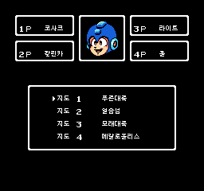
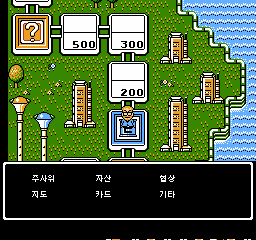
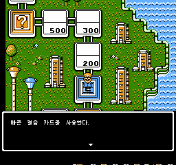

# 록보드 NES 한글패치 공개 테스트판

패미컴 게임 **Wily & Light no Rockboard — That's Paradise** 일본판용 비공식 한글패치입니다. `v0.1.0-beta.1`은 주요 대사와 메뉴를 반영한 공개 테스트판입니다. 미번역과 미검수 구간이 남아 있어 완성판으로 안내하지 않습니다.

원본 ROM이나 패치된 ROM은 제공하지 않습니다. 배포 ZIP에는 IPS 패치, 적용 안내, 검증 요약과 글꼴 라이선스만 들어 있습니다.

[패치 다운로드](https://github.com/kirby-gpt/rockboard-korean/releases/tag/v0.1.0-beta.1) · [오류 제보](https://github.com/kirby-gpt/rockboard-korean/issues)

## 반영 내용

- 대사 원고 452개를 반영했습니다. 같은 문장을 가리키는 항목을 포함하면 카탈로그 기준 512개입니다. 이는 번역 삽입 범위이며 전체 게임 검수율을 뜻하지 않습니다.
- 한글 타이틀, 플레이어 수, 캐릭터 이름, 지도 및 규칙 선택, 지도 소개와 승리 조건을 반영했습니다.
- 게임 하단 상태 표시, 행동 선택, 자산 및 거래 관련 메뉴와 카드 목록을 한글화했습니다.
- 카드명 23종을 대사에서도 표시하도록 수정했습니다.

## 준비할 원본

일본판 `Wily & Light no Rockboard - That's Paradise (J).nes`의 아래 해시와 일치하는 파일이 필요합니다. 파일 이름만 같아서는 호환을 보장할 수 없습니다.

- 형식: 16바이트 iNES 헤더가 있는 NES ROM
- 원본 크기: **262,160바이트**
- 원본 CRC32: `353DDA1F`
- 원본 SHA-256: `EBAFBEBC55CE25642B647C42D0983B8CEADE208560C95E64A86ED96B52383CDE`

직접 준비한 원본을 별도 보관하세요. 다른 번역판, 이미 패치한 파일, 헤더를 제거한 파일에는 적용하지 마세요.

## 적용 방법

1. 배포 ZIP을 풀고 `rockboard-ko-v0.1.0-beta.1.ips`를 꺼냅니다.
2. [Rom Patcher JS](https://www.marcrobledo.com/RomPatcher.js/) 등 IPS를 지원하는 패처를 엽니다.
3. ROM file에 일본판 원본, Patch file에 IPS를 선택한 뒤 패치를 적용합니다. 헤더 제거 또는 체크섬 자동 보정은 사용하지 마세요.
4. 생성된 새 `.nes` 파일을 Mesen에서 엽니다. 기존 ROM을 열어 둔 경우 새 파일로 다시 열어 주세요.

패치는 원본의 PRG-ROM을 256 KiB에서 512 KiB로 확장합니다. 적용 결과는 **524,304바이트**이며 SHA-256은 아래와 같아야 합니다.

`0AC71F0F2C7DE40EB39469FFEACF1F51CB79B041B3D8D696B3951BDD30212C84`

IPS의 SHA-256:

`C56B35E3D8860293569F53AF5F2CBDF62E12E2BBDBE4269C964C78651B168E33`

처음에는 저장 상태를 불러오지 말고 리셋 상태에서 시작해 주세요. 이전 번역판의 저장 상태 및 실기·플래시카트 호환성은 확인하지 않았습니다. 키보드 매핑은 에뮬레이터 설정에 따라 다릅니다.

## 확인한 범위

검증 환경은 **MesenCE 2.2.1**입니다.

- 자동 검사 354개 통과 및 원본에 IPS를 적용한 결과와 시험 ROM의 바이트 일치 확인
- 플레이어 수, 캐릭터, 지도, 규칙, 지도 소개, 하단 상태, 행동 메뉴 확인
- 네 지도 소개 화면 확인
- 최신 카드 수정판에서 이전 UI판과 동일 입력으로 얻은 화면 65장 일치
- 대표 카드의 사용, 버리기 확인, 버리기 완료 대사 확인

카드 세 장면은 빈 카드 칸에 카드 한 장을 넣는 **진단용 RAM 설정** 후 실제 메뉴를 조작해 확인했습니다. 모든 카드를 자연스럽게 획득하고 사용하는 전체 플레이 검증은 아닙니다. 자동 CPU 검사 역시 모든 NES 타이밍이나 엔딩 검수를 대신하지 않습니다.

## 알려진 한계

- 메트 경주자 이름 4종은 일본어로 남아 있습니다.
- 이름·아이템명 뒤의 조사 결합과 일부 문장은 다듬을 여지가 있습니다.
- 탈취 등 특수 카드 상황과 조건부 화면은 추가 검수가 필요합니다.
- 처음부터 엔딩까지의 전체 플레이 검수와 실기 검증은 완료하지 않았습니다.

안정성을 우선한다면 후속 검수판을 기다려 주세요.

## 오류 제보

화면 사진과 함께 버전, 에뮬레이터 이름·버전, 지도·캐릭터, 직전에 선택한 행동을 알려 주시면 재현에 도움이 됩니다. 게임 ROM은 제보에 첨부하지 마세요.

## 글꼴과 참고 자료

한글 글꼴은 NES의 8×8 셀에 맞춘 **Galmuri7**을 사용했습니다. 원본 파일 `Galmuri7.bdf`, 배포 버전 2.40.3, 내부 버전 2.403입니다.

- Copyright (c) 2019–2025 Lee Minseo
- SIL Open Font License 1.1, Reserved Font Name: Galmuri
- 글꼴 SHA-256: `2A6FD090AC6D24F7392D6CC49DB02CE54B9D1C01048BF8C97CBCDBC5A885CB15`
- 출처·버전 기록: `FONT_METADATA.json`
- 라이선스 전문: `Galmuri-OFL-1.1.md`

문장 대조 자료로 Dr. Cossack's Lab의 Rockboard English Translation v1.1을 참고했습니다. 해당 작업의 크레딧은 Dr. Cossack, Servbot #20, Guillermo, Elaine입니다. 영문 패치 자체는 이 배포에 동봉하지 않습니다.

원작 게임과 캐릭터의 권리는 해당 권리자에게 있습니다. 이 패치는 비공식 팬 번역이며 공식 한국어판이 아닙니다. 글꼴 라이선스는 글꼴에 대한 조건이며 원작 게임이나 전체 패치의 권리를 대신하지 않습니다.

## 실제 화면

